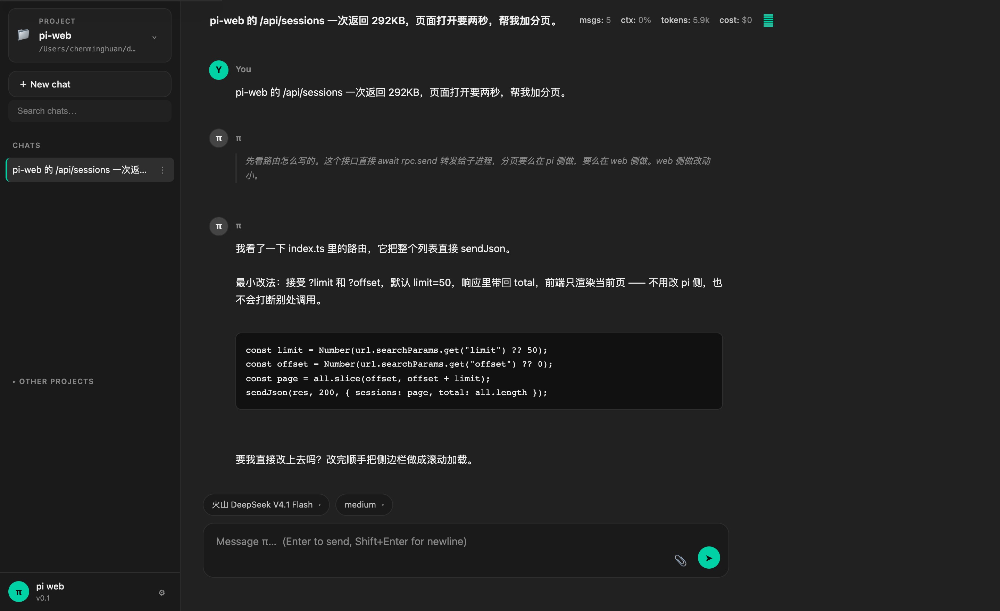
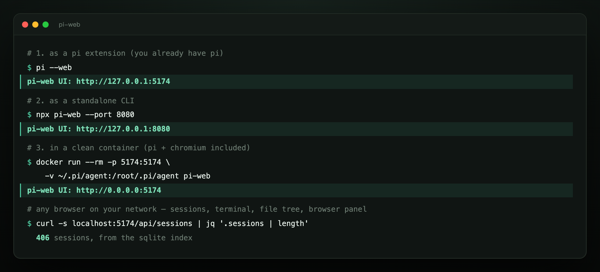
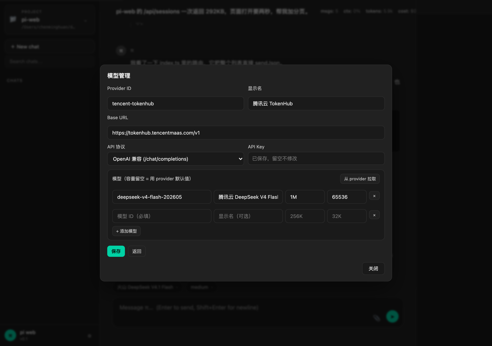

<div align="center">


<h1>π · web</h1>

<p><b>把 pi 搬进浏览器：会话、终端、文件树、浏览器面板，一页全在。</b></p>

<p>
  <a href="LICENSE"></a>
  
  
  
  
</p>

<p>
pi 是终端里的 coding agent。pi-web 用 HTTP + WebSocket 给它套一层 Codex 风格的前端：<br>
长会话留在机器上跑，笔记本 / 手机 / 平板打开浏览器就能接着聊 —— <b>自带模型管理，填个 key 就能用</b>。
</p>

<p><i>Codex-style web UI for pi — browse, fork and drive your sessions from any browser, with a built-in model manager.</i></p>

</div>



pi is a terminal coding agent. `pi-web` serves a full chat front-end over HTTP + WebSocket, so you can keep long sessions running on a machine and talk to them from a laptop, phone, or tablet on the same network.

## Features

- **Session browser** — every session file under `~/.pi/agent/sessions/`, grouped by project directory, paged 60 at a time (a 406-session store returns 46KB per page instead of 275KB)
- **Branch a conversation** — fork a session at any message, keep exploring without losing the original
- **Live streaming** — token-by-token over WebSocket, with tool calls and thinking blocks rendered inline
- **Model + thinking level switching** — from the composer, no restart
- **Built-in model manager** — add any provider (OpenAI-compatible, Anthropic, Google, local Ollama/vLLM), edit per-model capacities, probe reachability, discover models from the endpoint. Keys stay in local `models.json` and are never echoed back
- **First-run onboarding** — a fresh install has no provider, so the page says so and links straight to the manager instead of failing every message
- **Live stats** — context usage, tokens, cost per session
- **View tabs** — 会话 / 文件 / 终端 / 浏览器 in the header: the work area takes the full column instead of squeezing into a side panel
- **Round rail** — a thin tick strip on the right, one tick per user turn, sized by how much of the conversation that turn took; click to jump, the active turn is highlighted
- **Built-in PTY terminal** — a real shell at `/pty`, not a fake one
- **File browser** — tree + editor over the project workspace; right-click to **zip a file/folder** or **extract a `.zip`** (pure `node:zlib`, no zip dependency; never overwrites — extracts to `name-2/` instead)
- **Zero front-end dependencies** — 1.7k lines of hand-written ES modules, no framework, no bundler; the WebSocket server (`ws-lite.ts`) is a 182-line RFC 6455 implementation

## Docker

The whole thing runs in a clean container — no host tooling beyond Docker:

```bash
docker build -t pi-web .                                   # includes Chromium for the browser panel
docker build -t pi-web --build-arg WITH_BROWSER=0 .        # slim, no browser panel
docker run --rm -p 5174:5174 \
  -v "$HOME/.pi/agent:/root/.pi/agent" \
  -v "$PWD:/workspace" pi-web
```

`docker compose up` does the same thing. Mount `~/.pi/agent` to keep your sessions,
`auth.json` and the sqlite index; mount your project at `/workspace` so the agent and
the file panel see real files.

In a container Chromium is started headless (`--no-sandbox`, no `/dev/shm`); on a
desktop with a display it stays headed so you can watch the agent drive it.

## Requirements

- Node.js >= 22.5 (the session index uses `node:sqlite`)
- pi installed (`npm i -g @earendil-works/pi-coding-agent`) — pi-web is a control panel for pi, it is **not** a standalone agent

## Install

Three ways to run it — the container needs nothing but Docker.



```bash
npm i -g pi-web       # installs pi as a dependency too
pi-web                # http://127.0.0.1:5174
pi-web --port 8080 --host 0.0.0.0 --no-open
```

Or use it as a regular pi extension (no separate install):

```bash
# inside ~/.pi/agent/extensions/pi-web
pi --web                       # opens the UI automatically
pi --web --web-port 8080
```

## Security

The server has **no authentication**, by default it listens on `127.0.0.1` only. It can read your sessions, spawn shell commands and write files through the agent — binding it to `0.0.0.0` exposes all of that to your network. Put it behind a reverse proxy with auth (or an SSH tunnel) if you need remote access.

## Model manager

Settings (⚙) opens a provider manager backed by `<agentDir>/models.json` — the same file
pi reads. Bring your own key: no control plane, so a fresh install only needs a base URL
and a key.



- Provider rows show base URL, protocol, model count and a **masked** key — the stored key
  is never sent back to the browser.
- Per-model rows edit id, display name, context window and max output (`256K` / `1M`;
  leave blank to inherit the provider default).
- **从 provider 拉取** asks `GET {baseUrl}/models` and lets you pick from what the endpoint
  actually serves, instead of hand-typing ids.
- **测试** probes reachability and reports status, latency and model count.
- Pasted `NAME=value` shell lines, quoted keys and keys with whitespace are rejected
  before they reach the file.

## Session index (SQLite)

pi stores every session as JSONL under `<agentDir>/sessions/<encoded-cwd>/`. Walking
those files on each sidebar refresh costs seconds once you have a few hundred sessions.
pi-web mirrors the metadata into `<agentDir>/pi-web.sqlite` and serves `/api/sessions`
from there:

| | 405 sessions, cold start | afterwards |
|---|---|---|
| JSONL scan (pi's `SessionManager.listAll`) | 6.0 s | 2.0 s |
| SQLite index | 6.0 s (one-time build) | **0.02 s** |

The JSONL files remain the source of truth — the DB is a disposable cache. Delete
`pi-web.sqlite` at any time and it rebuilds itself. A cheap signature (file count +
newest mtime) decides when to rebuild; on a warm start the sidebar never waits for a
full scan.

## Testing

```bash
node test/smoke.mjs http://127.0.0.1:5174
```

Covers static assets, every read-only API, the WebSocket round-trip and the CDP
browser (tabs / navigate / screenshot). Exits non-zero on failure, safe to re-run.

Verified end to end in a clean container (`--network none`, no host files mounted):
13/13 checks pass, three consecutive runs.

## Architecture

```
bin/pi-web.mjs ──► index.ts (HTTP + WebSocket server)
                     │
                     └── spawn "pi --mode rpc" ──► the actual agent
```

`index.ts` is a pi extension (`export default function (pi)`) that registers the `--web*` flags and starts the server on `session_start`. The browser talks to it over `/ws`; the server proxies the conversation to a `pi --mode rpc` child process over stdin/stdout JSON lines. `bin/pi-web.mjs` is a standalone entry point that supplies the few `ExtensionAPI` members the extension needs, so it can run without the pi TUI.

## Notes / limitations

- `/api/sessions` still returns the whole list (~275KB for 405 sessions, ~30KB gzipped) — pagination is the next step.
- One browser session drives one pi child process; single-user by design.
- `PI_BIN` overrides which pi executable is spawned.

## License

MIT
